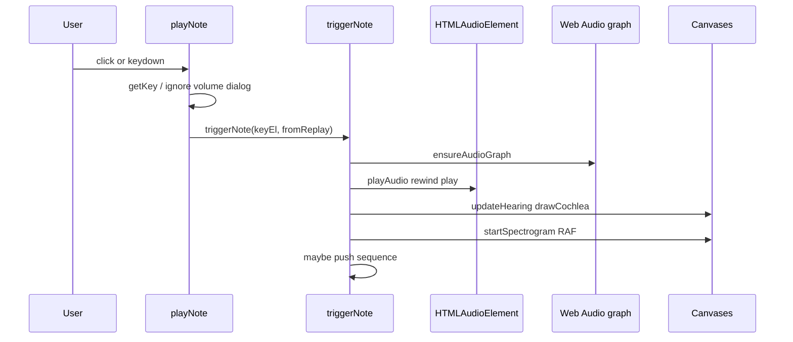

# Pianoforte — technical handbook and viva guide

This document is the detailed companion to [README.md](README.md). It explains **music theory**, **auditory science**, **digital audio**, and **how the code implements each feature**—so you can present the project confidently in a faculty review or viva.

**Quick demo line:** “Vanilla HTML/CSS/JS piano with WAV samples. One Web Audio graph: media sources → gain → analyser → speakers. The spectrogram is live FFT data; the basilar strip is a Greenwood-style educational map from nominal Hz—not a sensor.”

---

## Section 1: Project motivation and objectives

### Why this project exists

Sound is invisible. Students often memorize note names without connecting them to **frequency in hertz**, **harmonic structure**, or **where the cochlea is most sensitive along its length**. Pianoforte keeps those ideas on one screen: you perform an action (key press), hear a familiar piano tone, read the label and Hz, and see two complementary views—**time–frequency energy** (spectrogram) and **place pitch** (basilar marker).

### Relationship between music, sound, and hearing

- **Music** uses named pitches (C4, A4) and intervals.
- **Acoustics** describes those pitches as pressure waves with measurable frequency and spectrum.
- **Auditory science** explains how the ear and brain turn those waves into pitch, loudness, and timbre.

The application demonstrates the **acoustic** and **software** sides directly. The cochlear panel is an **illustrative computational model** aligned with place-pitch teaching—it does not measure your ear or brain.

### Educational problem

The project addresses: *How can a beginner see that “A4” is 440 Hz, that a piano tone is not a single sine wave, and that low vs high notes relate to different cochlear regions—without lab equipment?*

### Scope and intended users

- Undergraduate students in engineering, CS, or interdisciplinary “music + technology” courses.
- Anyone practicing DOM events, Web Audio, and canvas visualization in the browser.

### What it demonstrates vs what it cannot

| Demonstrates | Does not demonstrate |
| --- | --- |
| Note names, keyboard map, sample playback | Full 88-key piano |
| Nominal equal-tempered frequencies on keys | Real-time MIDI note-number → frequency computation in JS |
| Live FFT magnitude vs time (analyser) | Phase spectrogram or clinical audiometry |
| Simplified Greenwood-style place map from Hz | Individual listener anatomy, otoacoustic emissions, neural spikes |
| Record/replay of note **onsets** with timing | MIDI file export, multi-track DAW |

---

## Section 2: Music theory fundamentals

<a id="section-2-music-theory-fundamentals"></a>

### 1. Sound and pitch

**Sound** is a rapid variation in air pressure. **Frequency** is how many pressure cycles occur per second, measured in **hertz (Hz)**. For many musical tones, **higher frequency is heard as higher pitch** (within the audible range, roughly 20 Hz–20 kHz for young listeners).

### 2. What a musical note represents

A **note** is a named pitch class plus optional octave information. In this app, `data-note` holds names like `C4`, `A4`, `E5`.

### 3. Note names (A4, C4, C♯4)

- The letter (**C**, **D**, …) is the pitch class within the octave.
- **♯** (sharp) raises pitch by one semitone; this project uses ASCII `C#4` in HTML.
- The number (**4**, **5**) is the **octave** register (scientific pitch notation). **Middle C** is **C4**.

### 4. Octaves

An **octave** is the interval where the higher note’s frequency is **double** the lower. Example: A4 = 440 Hz, A5 = 880 Hz. The keyboard includes C4 through E5—just over one octave of white keys plus extensions.

### 5. Semitones and 12-tone equal temperament

Western equal temperament divides the octave into **12 equal semitones**. Each semitone multiplies frequency by \(2^{1/12}\).

### 6. MIDI note number to frequency

Standard reference:

\[
f = 440 \times 2^{(n - 69) / 12}
\]

| Symbol | Meaning |
| --- | --- |
| \(f\) | Frequency in Hz |
| \(n\) | MIDI note number (integer) |
| 69 | MIDI number for **A4** |
| 440 | Concert pitch for A4 in Hz |

**In this repository:** frequencies are **authored in HTML** as `data-freq` on each key (e.g. A4 = `440.00`). They match the formula above for the implied MIDI numbers (C4 = 60, …, E5 = 76). **`script.js` does not compute this formula at runtime**—it reads `dataset.freq` for display and the cochlea marker.

### 7. Piano keys, names, and keyboard shortcuts

Each `.key` has:

- `data-keyboard` — hint letter
- `data-key` — numeric code matched to `<audio data-key="…">` (keyboard uses `e.keyCode` for the same numbers)
- `data-note`, `data-freq`

White: `A S D F G H J K L ;` · Black: `W E T Y U O P`.

### 8. Why different notes can “feel related”

Notes an octave apart share harmonic spacing patterns and sound “the same letter” despite different frequencies. Intervals like fifths and fourths also have simple frequency ratios in just intonation; equal temperament slightly adjusts ratios for modularity across keys.

### 9. Timbre and harmonics

**Timbre** is “tone color.” Real instruments produce a **fundamental** plus **harmonics** (integer multiples of the fundamental). Piano samples in this project are **recorded tones**, so the spectrogram should show energy at the fundamental and at higher bands—unlike a pure sine wave.

---

## Section 3: How human hearing encodes pitch

*Undergraduate-level overview; not a substitute for a physiology course.*

### Pathway in brief

1. **Outer/middle ear:** Sound pressure is collected and coupled to the fluid-filled **cochlea**.
2. **Cochlea:** A snail-shaped structure; inside, the **basilar membrane** varies in stiffness along its length.
3. **Tonotopy:** The **apex** (wide, floppy) responds better to **low** frequencies; the **base** (narrow, stiff) to **high** frequencies.
4. **Traveling wave:** Energy propagates along the membrane; maximum vibration occurs at a **place** that depends on frequency—basis for **place theory** of pitch.
5. **Hair cells:** Mechanoreceptors convert membrane motion to neural activity.
6. **Temporal coding:** At lower frequencies, timing of nerve firings relative to the waveform period can also carry pitch information (**phase locking**). Place and time mechanisms coexist; this app emphasizes **place** visually.

### Link to the application

| Biology concept | App feature |
| --- | --- |
| Tonotopic map | `drawCochlea` — apex left (20 Hz label), base right (20 kHz) |
| “Where” a frequency peaks | Vertical marker at `greenwoodFractionFromApex(freq)` |
| Apical vs basal emphasis | Caption toggles at `KEYBOARD_MID_HZ` (400 Hz) for pedagogy |

### Computational model vs real hearing

- The marker uses **nominal** `data-freq`, not FFT peak tracking.
- Constants `A = 165.4`, `k = 0.88` in `greenwoodFractionFromApex` implement a **Greenwood-style log map** between 20 Hz and 20 kHz—an approximation used in auditory modeling, not a measurement from your cochlea.
- No EEG, no microphone of the room, no individualized audiogram.

---

## Section 4: Sound synthesis and digital audio

### How a note is produced here

**Not oscillators.** Each key plays a **WAV file** via `<audio>` (`audio/040.wav` … `audio/056.wav`). Filenames are sequential sample IDs; they are **not** MIDI note numbers.

Flow in `playAudio`:

1. Select `audio[data-key="${key}"]`
2. Set `audio.volume = currentVolume`
3. `audio.currentTime = 0` (retrigger from start)
4. `audio.play()`

### Web Audio graph (after first note)

`ensureAudioGraph()` in `script.js`:

```
each <audio> → MediaElementSource → GainNode → AnalyserNode → destination
```

- **GainNode:** master loudness from the slider (`setVolume`).
- **AnalyserNode:** `fftSize = 2048`, `smoothingTimeConstant = 0.7`.
- **Sample rate:** `audioContext.sampleRate` (device-dependent, often 48 kHz)—used for Nyquist in the spectrogram.

### Volume before vs after graph

On load, `setVolume` updates `HTMLMediaElement.volume` only. After the graph exists, `gainNode.gain` is the primary control; elements still get `audio.volume` updated for consistency.

### Duration and release

There is no envelope generator. Sample length and decay are **whatever is in the WAV**. The `.playing` CSS class is removed on `transitionend` on the key—not tied to audio end.

### Polyphony

Each note has its own `<audio>` element and `MediaElementSource`. Overlapping presses can overlap samples (browser-dependent mixing).

### Recording and playback

- **Record:** While `isRecording`, each user-initiated `triggerNote` appends `{ key, delayMs }` where `delayMs` is elapsed time since the previous note (`performance.now()`).
- **Replay:** `playLastSequence` schedules `setTimeout` chains calling `triggerNote(keyElement, true)` so replay does not append to the sequence (`fromReplay` flag).

---

## Section 5: Spectrogram and frequency analysis

For memorizable one-liners, FFT vs FTP, and short viva answers, see **[Glossary and viva notes (FFT and related)](#glossary-and-viva-notes-fft-and-related)** (§9.1–9.6).

### Time vs frequency domain

- **Time domain:** amplitude vs time (waveform)—not drawn in the UI.
- **Frequency domain:** magnitude vs frequency at a slice of time—what the analyser exposes each frame.

### FFT role

The `AnalyserNode` performs a **real-time FFT** (browser implementation) on the mixed signal at the analyser input. `getByteFrequencyData` returns **unsigned byte magnitudes** (0–255), not linear pressure units.

### Bins and resolution

With `fftSize = 2048`, there are `frequencyBinCount = 1024` bins from 0 to Nyquist \(f_s/2\). Bin width is roughly \(f_s / \text{fftSize}\) (order of magnitude; exact windowing is internal to the browser).

### How the spectrogram is drawn (`drawSpectrogramFrame`)

1. Shift canvas left by 1 px: `ctx.drawImage(canvas, -1, 0)`.
2. For each row `y`, map row to a **log-frequency** target:
   `freq = FREQ_MIN * (FREQ_MAX/FREQ_MIN)^(1 - y/height)` with 20 Hz–20 kHz.
3. Map `freq` to a bin index using Nyquist and `freqData.length`.
4. Paint one column on the right edge; color scales with normalized magnitude.

**Data source:** Live analyser output while notes play. `startSpectrogram` runs `requestAnimationFrame`; `SPECTROGRAM_IDLE_MS` (1800) stops the loop after idle.

**Not:** prerecorded images, offline WAV analysis, or room microphone input.

### Reading fundamentals and harmonics

Look for a bright band near the nominal fundamental (from `data-freq`) and additional bands near integer multiples. Finite resolution can smear adjacent harmonics.

### Limitations

- Byte frequency data is compressed magnitude; no phase.
- Log mapping per pixel row is a **display choice**, not the analyser’s native linear bin grid.
- When multiple notes overlap, the FFT shows their **sum**.

---

## Glossary and viva notes (FFT and related)

Evaluators often ask about **FFT**, **spectrogram**, and Web Audio terms. This project does **not** use **FTP** (File Transfer Protocol). If you hear “FTP” in a viva, clarify: **this app uses FFT — Fast Fourier Transform — for frequency analysis**, not FTP.

### 9.1 One-line answers (memorize these)

| Term | One-line answer for this project |
| --- | --- |
| **FFT** | Math that splits a slice of audio into sine waves at different frequencies; the browser’s `AnalyserNode` runs an FFT for us. |
| **Spectrogram** | A picture of how loud each frequency is over time; we scroll it on a canvas while you play. |
| **AnalyserNode** | Web Audio node that exposes FFT results via `getByteFrequencyData`. |
| **Frequency bin** | One bucket in the FFT output (we have 1024 bins when `fftSize = 2048`). |
| **Nyquist frequency** | Half the sample rate — highest frequency the digital system can represent (used when mapping bins to Hz). |
| **Fundamental** | Lowest main frequency of the note (e.g. 440 Hz for A4). |
| **Harmonic** | Energy at 2×, 3×, … the fundamental; piano samples show several in the spectrogram. |
| **GainNode** | Volume control in the Web Audio graph. |
| **Greenwood map** | Log formula approximating where on the cochlea a frequency peaks; we use it only for the **marker**, not from live FFT. |
| **Place pitch** | Idea that pitch relates to *where* on the basilar membrane vibration is largest. |

### 9.2 What is FFT? (plain explanation)

**FFT = Fast Fourier Transform.**

- **Input:** A short chunk of audio in the **time domain** (amplitude changing over time, like a waveform).
- **Output:** The same chunk described in the **frequency domain** — how much energy sits near 100 Hz, 440 Hz, 880 Hz, and so on.
- **Why “Fast”:** The same result as the Discrete Fourier Transform (DFT) but with fewer operations, so it can run in real time in the browser.

**In Pianoforte:** You do **not** implement FFT yourself. After the first note, each `<audio>` element feeds a shared `AnalyserNode` with `fftSize = 2048`. Every animation frame, `drawSpectrogramFrame` calls:

```javascript
analyserNode.getByteFrequencyData(freqData);
```

That fills `freqData` with **1024** unsigned byte values (0–255), each representing magnitude in a **frequency bin**. The code maps those bins to a **log-frequency** vertical axis (20 Hz–20 kHz) and draws one vertical column on the right of the spectrogram canvas.

### 9.3 FFT size 2048 — what does that mean?

| Setting | Value in this project | Meaning |
| --- | ---: | --- |
| `fftSize` | 2048 | FFT window length (samples); must be power of 2 |
| `frequencyBinCount` | 1024 | Number of magnitude bins (= `fftSize / 2`) |
| Bin spacing (approx.) | `sampleRate / 2048` | e.g. at 48 kHz ≈ 23.4 Hz per bin |

**Trade-off (general DSP knowledge):** A **larger** FFT window gives **finer frequency resolution** but **slower time resolution** (each column averages over a longer slice of sound). This project uses the browser default windowing inside `AnalyserNode`; we only set `fftSize` and `smoothingTimeConstant` (0.7).

### 9.4 Spectrogram vs waveform

| | **Waveform** | **Spectrogram (this app)** |
| --- | --- | --- |
| Axes | Amplitude vs time | Frequency (vertical) vs time (horizontal scroll) |
| Shown in UI? | No | Yes — `#spectrogram` canvas |
| Data source | — | Live FFT magnitudes from analyser |

A **pure tone** would look like one bright horizontal band. A **piano sample** looks like a band at the fundamental plus weaker bands at harmonics.

### 9.5 Web Audio path (say this in a viva)

```
WAV file → <audio> → MediaElementSource → GainNode (volume) → AnalyserNode (FFT) → speakers
                                                              ↘
                                                         spectrogram canvas
```

The **basilar membrane** canvas does **not** read the FFT. It uses the **nominal** frequency from HTML (`data-freq`) and `greenwoodFractionFromApex(freq)`.

### 9.6 Sample viva Q&A (short)

**Q: What is FFT and where do you use it?**  
**A:** FFT converts a time-domain audio block into frequency components. We use the browser’s `AnalyserNode` (FFT size 2048) and read magnitudes with `getByteFrequencyData` to paint the spectrogram.

**Q: Is the spectrogram prerecorded?**  
**A:** No. It updates from **live** analyser output while notes play, then stops ~1.8 s after the last trigger.

**Q: Does the cochlea diagram use FFT?**  
**A:** No. It uses the labeled Hz on each key and a Greenwood-style formula for position.

**Q: FTP?**  
**A:** Not used. If the question is about spectra, they mean **FFT**. FTP is unrelated file-transfer protocol.

**Q: What is a harmonic?**  
**A:** Integer multiple of the fundamental; piano timbre comes from many harmonics, visible as stacked energy in the spectrogram.

---

## Section 6: Basilar membrane visualization

### Why frequency maps to place

Along the basilar membrane, mechanical tuning varies: stiff base → high frequencies; compliant apex → low frequencies.

### Implementation (`greenwoodFractionFromApex`)

```javascript
const A = 165.4;
const k = 0.88;
const pos = (f) => Math.log10(f / A + k);
// normalized between FREQ_MIN (20) and FREQ_MAX (20000)
```

Marker horizontal position: `12 + fraction * (width - 24)` on the canvas.

### Axes and labels

- Gradient bar: illustrative membrane strip (apex left, base right).
- Text: `20 Hz`, `20 kHz`, `apex`, `base`.
- On play: vertical line and note label above the strip; `#place-caption` shows note + Hz.

### Scientific status

Treat this as a **simplified educational model** inspired by Greenwood-type cochlear frequency–distance functions. It is **not** validated against individual CT scans or psychoacoustic tuning curves in this codebase.

---

## Section 7: Technical architecture and implementation

### Entry points

- `index.html` loads `script.js` with `defer`.
- `window` `load` → `registerEvents()`.

### Module map (single file)

| Concern | Functions / handlers |
| --- | --- |
| Input | `playNote`, `getKey`, `shouldIgnorePianoKeys` |
| Playback | `triggerNote`, `playAudio`, `addPlayingClass`, `removePlayingClass` |
| Audio graph | `ensureAudioGraph`, `setVolume` |
| Sequence | `toggleRecording`, `playLastSequence`, `stopReplay`, `updateSequenceUi` |
| Hearing UI | `updateHearing`, `drawCochlea`, `greenwoodFractionFromApex` |
| Spectrogram | `startSpectrogram`, `stopSpectrogram`, `drawSpectrogramFrame`, `fillSpectrogramBackground` |
| Help UI | `registerSpectrumInfo` |

### Event flow (detailed)



### DOM and CSS responsibilities

- **Delegation:** one `click` on `.piano`; `closest(".key")` for target.
- **Visual press:** `.playing` + `transitionend` cleanup (ignore `SPAN` transitions).
- **Layout:** `.workspace` grid — instrument left, `.hearing` right; stacks below 980px.

### Dependencies

Only CDN fonts; all logic is first-party.

---

## Section 8: Implementation decisions and trade-offs

| Decision | Rationale (from behavior) | Trade-off |
| --- | --- | --- |
| WAV samples vs oscillators | Piano-like timbre with minimal code | No per-note synthesis params; large files vs tiny sine generator |
| `MediaElementSource` | Reuses `<audio>` tags and familiar playback | One source per element; graph must be built once |
| Single delegated click listener | Demonstrates event delegation; fewer listeners | Must use `closest` for nested spans |
| `keyCode` mapping | Matches `data-key` integers | Deprecated; layout-specific (`186` semicolon) |
| Analyser on master gain | One spectrogram for mixed output | Cannot see per-note paths without separate analysers |
| Cochlea from `data-freq` | Stable teaching marker | May not coincide with spectral centroid of sample |
| `setTimeout` replay | Simple timing without AudioContext scheduling | Not sample-accurate; drift possible under load |
| Canvas scroll spectrogram | Classic “waterfall” look | CPU paint per frame; stops when idle |

**Autoplay:** `audioContext.resume()` if suspended—still requires user gesture policy compliance.

---

## Section 9: Testing and validation

### Automated tests

**None** in the repository (no test runner, no `*test*` files). Do not claim CI or unit tests passed unless you add them.

### Manual functional checks

| Check | Expected |
| --- | --- |
| Each key mouse/keyboard | Matching WAV, note name updates |
| Rapid repeat | Rewind to 0; audible retrigger |
| Volume 0 | Silence; piano keys unaffected |
| Record → Stop → Play | Same count; timing roughly preserved |
| Replay | Does not increase `sequence.length` |
| Dialog open | Piano keys ignored (`shouldIgnorePianoKeys`) |
| C4 vs E5 | Marker moves right; spectrogram energy higher on screen |

### Frequency accuracy

Compare `data-freq` in `index.html` to \(440 \times 2^{(n-69)/12}\). **Sample pitch** in WAV files was not verified in this documentation pass—only the **declared** Hz attributes.

### Spectrogram sanity

Play A4: look for energy near 440 Hz band (mapped through log-y and bin quantization). Compare to silence: idle stop after ~1.8 s.

### Resource leaks

Repeated play should not create multiple contexts—`audioGraphReady` guards creation. Replay clears timers in `stopReplay` when recording restarts.

### Scientific vs functional validation

Functional: keys work, graph builds, FFT moves when sound plays. Scientific: Greenwood marker is illustrative; FFT is magnitude-only and browser-dependent.

---

## Section 10: Limitations, improvements, and future scope

### Current limitations

- 17-key range; no pedal; no velocity layers.
- Keyboard mapping not internationalized.
- Recording stores key IDs and inter-onset delays only—not continuous audio.
- Spectrogram stops when idle though audio may still be ringing out.
- `initial_report.txt` predates record/FFT features—historical report only.

### Achievable improvements (2+ weeks)

1. Replace `keyCode` with `e.code` map table.
2. FFT peak picker to drive cochlea marker vs nominal Hz.
3. More octaves + lazy-loaded samples.
4. Web Audio `scheduled` replay for tighter timing.
5. Export sequence as JSON or MIDI.
6. Automated smoke tests (Playwright: click key, assert audio playing).
7. Carnatic swara labels (per `initial_report.txt` proposal).

---

## Viva and faculty review — question bank

Answers are grounded in this repo. **Verify** items marked when you have not run them yourself in the target browser.

### Project overview

**Q1: What problem does the project solve?**  
It links piano notes, frequencies, spectra, and a place-pitch metaphor in one interactive page for learners.

**Q2: Why choose this topic?**  
It combines web skills (DOM, events, Web Audio) with music and hearing science in a demonstrable artifact.

**Q3: What is novel or educationally valuable?**  
Not a new synthesizer—the value is **integration**: sample playback, live FFT, and cochlear place visualization with clear disclaimers.

**Q4: What happens when the user presses a key?**  
`keydown` → `playNote` → `getKey` (`keyCode`) → `triggerNote` → audio play, `.playing`, note text, `updateHearing`, spectrogram RAF, optional sequence entry.

**Q5: Main modules?**  
`index.html` (structure/data), `style.css` (presentation), `script.js` (behavior), `audio/*.wav` (media).

**Q6: Is sound synthesized?**  
No. Pre-recorded WAV files played through `<audio>` and routed into Web Audio after first gesture.

### Music theory and acoustics

**Q7: What is pitch vs frequency?**  
Pitch is perceived height; frequency is physical cycles per second. The app shows both via name and `data-freq`.

**Q8: Why does doubling frequency give an octave?**  
Harmonic spacing repeats; brains fuse octave-related tones. Mathematically, \(f_2 = 2 f_1\).

**Q9: What is equal temperament?**  
12 equal semitones per octave; ratio \(2^{1/12}\) per step. HTML frequencies follow concert A4 = 440 Hz.

**Q10: How do you calculate frequency of a note?**  
Standard: \(f = 440 \times 2^{(n-69)/12}\). Here, frequencies are **stored** in `data-freq`, not computed in JS.

**Q11: Pitch vs loudness vs timbre?**  
Pitch ≈ fundamental frequency; loudness ≈ amplitude (gain slider); timbre ≈ spectrum shape (harmonics in piano samples).

**Q12: What are harmonics?**  
Integer multiples of the fundamental; visible as stacked energy in the spectrogram.

**Q13: Why do two instruments sound different on the same note?**  
Different harmonic amplitudes and transients → different timbre.

### Auditory science

**Q14: What is the basilar membrane?**  
A structure inside the cochlea that vibrates selectively along its length.

**Q15: What is tonotopic organization?**  
Neighboring sensory regions map to neighboring frequencies—apex low, base high.

**Q16: Why does the base favor high frequencies?**  
Shorter, stiffer region resonates for faster pressure changes.

**Q17: Place vs temporal coding?**  
Place: which region is most active; temporal: firing synchronized to waveform period. App emphasizes place via marker.

**Q18: How does the project represent biological encoding?**  
A Greenwood-style fraction maps nominal Hz to horizontal position on a canvas strip.

**Q19: How is the model different from real hearing?**  
No neural noise, no head shadow, no individual differences; marker uses labeled Hz, not otoacoustic measurement.

### Digital signal processing

**Q20: What is an FFT?**  
Algorithm decomposing a time signal into sinusoidal components; analyser exposes magnitude bins.

**Q21: What is a spectrogram?**  
Frequency content vs time—here built by scrolling FFT columns.

**Q22: Waveform vs spectrogram?**  
Waveform is amplitude vs time; spectrogram is magnitude (color) vs frequency and time.

**Q23: How identify a fundamental?**  
Lowest strong band related to pitch; for piano, also check harmonics at 2×, 3×, …

**Q24: What are frequency bins?**  
FFT output samples across 0…Nyquist; this project uses 1024 bins for fftSize 2048.

**Q25: What sets time–frequency resolution?**  
Window length (fftSize) vs update rate (animation frames); larger FFT → finer frequency steps, slower time response.

### Implementation and engineering

**Q26: Technology stack?**  
HTML, CSS, vanilla JS, Web Audio API, Canvas 2D, Google Fonts CDN.

**Q27: Why WAV samples?**  
Realistic piano timbre without implementing physical modeling.

**Q28: Note → frequency in code?**  
Read `keyElement.dataset.freq` in `updateHearing`; not derived from filename.

**Q29: Keyboard events?**  
`window` `keydown` → `playNote`; ignored for volume, buttons, open dialog.

**Q30: How does recording work?**  
Array of `{ key, delayMs }` on each `triggerNote` while `isRecording`.

**Q31: How is playback timed?**  
Cumulative `setTimeout` delays from stored `delayMs`.

**Q32: How are visualizations updated?**  
Cochlea: immediate redraw on note. Spectrogram: RAF loop while active.

**Q33: Overlapping notes?**  
Separate `<audio>` elements; mixed before analyser.

**Q34: Main limitations?**  
Range, deprecated `keyCode`, nominal cochlea marker, no automated tests.

**Q35: Test frequency accuracy?**  
Compare `data-freq` to MIDI formula; optionally analyze WAV with external tool (**verify** sample content).

**Q36: Two more weeks?**  
`e.code` map, scheduled replay, FFT-based marker, tests, more samples.

### Questions I should be ready to demonstrate live

1. Play **A4** with mouse and keyboard; show **440 Hz** caption and spectrogram band.
2. Play **C4** then **E5**; marker moves toward the base; read apical/basal caption.
3. Open spectrogram **i** dialog; explain log axis and harmonics.
4. Set volume to 0% and back; show slider arrow keys do not trigger notes.
5. **Record** a 3-note motif, **Stop**, **Play**; point out replay does not add notes to sequence.
6. Show `data-key` join between a key `div` and `<audio>` in DevTools.
7. Optional: DevTools → check `AudioContext` state after first click (**verify** in your browser).

---

## Appendix: File reference

| File | Responsibility |
| --- | --- |
| `index.html` | Keys with `data-*`, toolbar, canvases, dialog, audio list |
| `script.js` | All runtime logic (~430 lines) |
| `style.css` | Theme, piano geometry, hearing panel, responsive rules |
| `audio/040.wav`–`056.wav` | One sample per key |
| `bg_image.png` | Full-page background |
| `initial_report.txt` | Early project report (partially outdated) |

---

## Change log

### 2026-10-23 — documentation pass

- **What:** Rewrote `README.md` and `PROJECT.md` for accuracy against current code: WAV + Web Audio graph, live spectrogram, Greenwood-style cochlea, record/replay, viva Q&A.
- **Why:** Faculty/viva and portfolio need verified implementation detail, not outdated report text.
- **Files:** `README.md`, `PROJECT.md`
- **Verify personally:** Actual pitch content inside each WAV file; browser-specific `keyCode` on your keyboard layout.

### Prior UI/feature history (summary)

2026-10-23 entries in the previous notebook covered: hearing panel, record/replay, volume, Pianoforte shell, cool theme, layout changes. See git history for file-level diffs.
