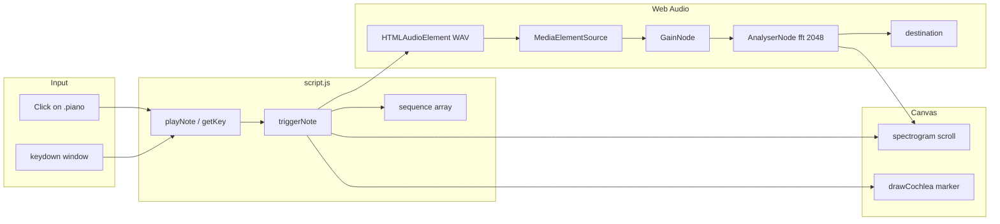

# Pianoforte

**Pianoforte** is a browser-based virtual piano that links **musical pitch**, **digital audio**, and **how the ear encodes frequency**. You play seventeen keys (C4–E5) with the mouse or computer keyboard, adjust volume, record a short phrase and replay it, and watch a **real-time spectrogram** plus an **illustrative basilar-membrane place map** driven by the same audio you hear.

**Portfolio summary:** A vanilla HTML/CSS/JavaScript instrument using **WAV samples** and the **Web Audio API**—no framework or build step. Playback routes through a shared `GainNode` and `AnalyserNode`; visualizations are a software model of that signal, not a microphone or clinical hearing test.

For music theory, auditory science, implementation detail, and viva preparation, see **[PROJECT.md](PROJECT.md)**.

---

## Problem and learning objective

Beginners often learn note names separately from **frequency (Hz)** and from **cochlear place pitch** (which part of the inner ear responds to which band). This project keeps all three in one screen: press a key, hear a piano tone, read the note name and nominal Hz, see energy in the spectrogram, and see where that frequency would peak on a simplified uncoiled basilar membrane.

---

## Features

| Feature | Status | Notes |
| --- | --- | --- |
| Interactive piano (mouse click) | Implemented | Event delegation on `.piano` |
| Computer-keyboard play | Implemented | Uses `keydown` + legacy `keyCode` |
| Hover hints (note + shortcut) | Implemented | CSS opacity on `.piano:hover` |
| Volume slider (0–100%) | Implemented | `GainNode` after first note; `HTMLMediaElement.volume` before graph exists |
| Record / Stop sequence | Implemented | Stores `{ key, delayMs }`; new record replaces previous |
| Play last sequence | Implemented | `setTimeout` replay; not re-recorded |
| Large note name display | Implemented | Octave-qualified labels (`C4` … `E5`) |
| Nominal frequency per key | Implemented | `data-freq` in HTML (equal-tempered Hz) |
| Scrolling spectrogram | Implemented | Live `AnalyserNode` FFT (`fftSize` 2048) |
| Basilar membrane marker | Implemented | Greenwood-style log map; marker from `data-freq` |
| Spectrogram **i** dialog | Implemented | Explains axes, harmonics, disclaimer |
| Piano synthesis (oscillators) | Not used | Tones are **pre-recorded WAV** files |
| Sustain pedal / velocity | Not implemented | — |
| Automated tests | Not present | Manual validation only |
| MIDI hardware input | Not implemented | — |

**Keyboard range:** white keys `A S D F G H J K L ;`, black keys `W E T Y U O P`. The last white key uses `keyCode` **186** (semicolon on common US layouts).

---

## Music and auditory concepts (short)

| Concept | In this app |
| --- | --- |
| Musical note & pitch | Each key has `data-note` (e.g. A4) and a played WAV |
| Octaves & semitones | C4→C5 is one octave; each step is one semitone in the 17-key window |
| Equal temperament | `data-freq` values match \(f = 440 \times 2^{(n-69)/12}\) (see [PROJECT.md §2](PROJECT.md#section-2-music-theory-fundamentals)) |
| Hertz & perceived pitch | Higher Hz → higher pitch; caption shows Hz on the membrane view |
| Harmonics & timbre | Piano samples show a fundamental plus overtones in the spectrogram |
| Spectrogram | Time–frequency plot from the analyser while notes play |
| Basilar membrane & tonotopy | Simplified apex (low) ↔ base (high) map; marker position from nominal frequency |

---

## Technology stack

| Technology | Purpose | Where used |
| --- | --- | --- |
| HTML5 | Structure, piano keys, `<audio>`, `<dialog>` | `index.html` |
| CSS3 | Layout, keys, panels, responsive grid | `style.css` |
| JavaScript (ES5-style, `"use strict"`) | Events, audio graph, record/replay, canvases | `script.js` |
| Web Audio API | `AudioContext`, `MediaElementSource`, `GainNode`, `AnalyserNode` | `script.js` → `ensureAudioGraph`, `drawSpectrogramFrame` |
| HTMLMediaElement | WAV playback | `<audio src="audio/040.wav" …>` |
| Canvas 2D | Spectrogram scroll + cochlea strip | `#spectrogram`, `#cochlea` |
| Google Fonts | DM Sans, Inter, IBM Plex Mono | `index.html` (CDN) |
| Python `http.server` | Local static hosting (documented) | Optional; not a project dependency |

No npm, bundler, or test runner is configured in this repository.

---

## Architecture and project structure

```
Piano/
├── index.html          # UI, data-* on keys, audio tags, spectrum dialog
├── script.js           # All application logic
├── style.css           # Visual design and layout
├── audio/              # 17 WAV samples (040.wav … 056.wav)
├── bg_image.png        # Page background
├── favicon.ico
├── README.md           # This overview
├── PROJECT.md          # Deep dive + viva Q&A
└── initial_report.txt  # Earlier written report (partially outdated)
```

### Data flow (user input → sound → visuals)



**Join key:** `data-key` on each `.key` div matches `data-key` on the corresponding `<audio>` element. Pitch education uses `data-note` and `data-freq`; WAV filenames are sample IDs only.

---

## Installation and execution

There is **no install step** and **no build step**.

```bash
git clone <your-repo-url>
cd Piano
python3 -m http.server 8000
```

Open [http://localhost:8000](http://localhost:8000). Stop with `Ctrl+C`.

If port 8000 is busy: `python3 -m http.server 8080` and open port 8080.

**Browser notes:**

- **User gesture:** The `AudioContext` is created on the first successful note trigger (`ensureAudioGraph`). Some browsers block audio until interaction; use click or key press.
- **Autoplay policies:** Prefer `http://` over `file://`; local server is more reliable for Web Audio + media.
- **Web Audio support:** Required for volume via `GainNode` and for the spectrogram. If `AudioContext` is missing, playback may still use `<audio>` only (visualizations need the graph).

---

## How to use

1. **Play:** Click a key or press its mapped letter. The key briefly scales down (`.playing`); the note name appears under the piano.
2. **Volume:** Drag the header slider. Arrow keys on the slider adjust volume and are **not** treated as piano keys.
3. **Record:** Click **Record**, play a melody, click **Stop**. Status shows note count. Starting a new record clears the previous sequence.
4. **Replay:** Click **Play** (disabled while recording or during playback).
5. **Spectrogram:** Scrolls while audio plays; idle ~1.8 s after the last note stops the animation loop.
6. **Basilar membrane:** Vertical marker and caption update per note; compare C4 (~262 Hz) vs E5 (~659 Hz).
7. **Help:** Click **i** next to “Spectrogram” for in-app explanation.

---

## Limitations and future work

**Current limitations (verified in code):**

- One octave-plus range only (17 keys).
- `e.keyCode` is deprecated; layout-specific semicolon mapping.
- No note-off / sustain; each press restarts the full sample (`currentTime = 0`).
- Cochlea position uses **nominal** `data-freq`, not peak-picking from the FFT.
- No automated tests; no export of recordings.
- `initial_report.txt` describes an older scope (no record/FFT)—trust this README and `PROJECT.md` for current behavior.

**Realistic extensions:** `e.code`-based keyboard map, more octaves, MIDI input, sample crossfade, fundamental detection for the membrane marker, accessibility (ARIA live regions), sequence export, optional Carnatic labels (as noted in `initial_report.txt`).

---

## References

- Moore, B. C. J. *An Introduction to the Psychology of Hearing* (pitch, loudness, cochlear mechanics).
- Hartmann, W. M. *Signals, Sound, and Sensation* (Fourier view of hearing).
- Fletcher, H., & Rossing, T. D. *The Physics of Musical Instruments* (piano acoustics, harmonics).
- Greenwood, D. D. (1990). A cochlear frequency-position function for several species—basis for the simplified Greenwood map in code.
- [MDN: Web Audio API](https://developer.mozilla.org/en-US/docs/Web/API/Web_Audio_API) — `AudioContext`, `AnalyserNode`, `getByteFrequencyData`.

---

## Acknowledgements

Based on a vanilla JavaScript piano structure (see project history in [PROJECT.md](PROJECT.md)). Font files loaded from Google Fonts. Piano samples are individual WAV files under `audio/`.
