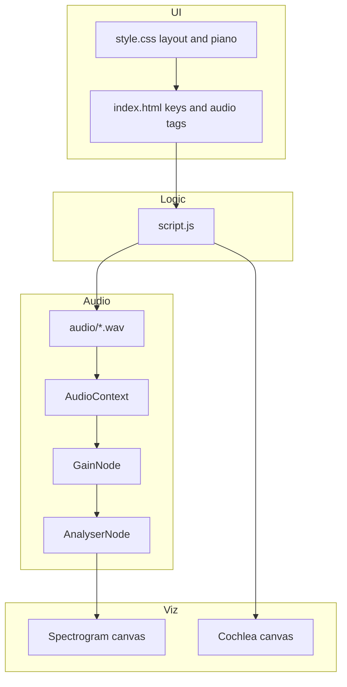
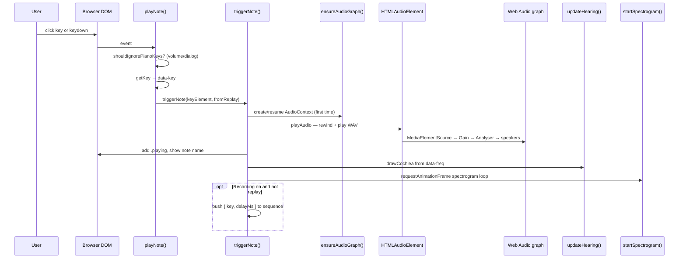
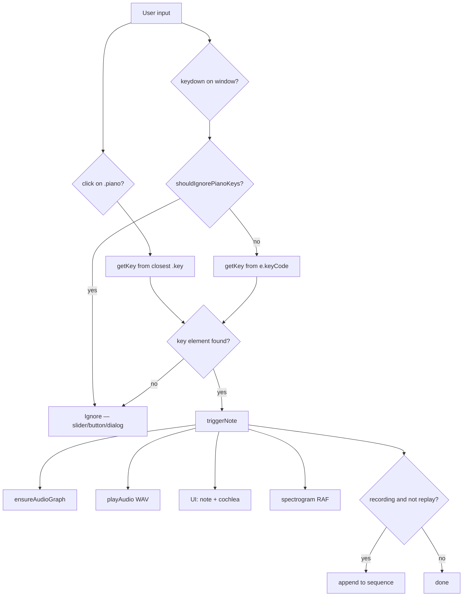
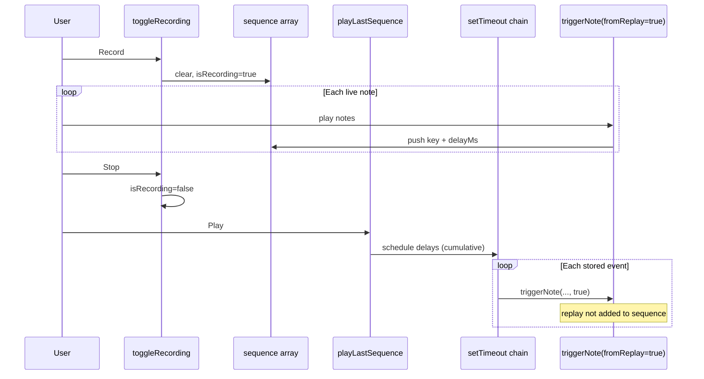
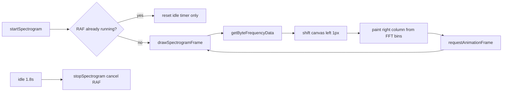

# Final Report: Pianoforte — Browser-Based Virtual Piano with Hearing Visualizations

**Project:** Pianoforte  
**Theme alignment:** Music, IoT, Robotics and Smart Systems (PD4) — interactive music interface with software-based auditory visualization  
**Implementation:** HTML5, CSS3, JavaScript, Web Audio API, Canvas 2D  
**Repository:** Vanilla static web application (no framework, no build step)

**This document is written as a standalone report for faculty / evaluators.** You do not need other files to understand what was built, how it works, or what to ask in a viva. Optional extras in the repo: `README.md` (short overview), `PROJECT.md` (extended Q&A).

### Evaluator at a glance

| Item | Detail |
| --- | --- |
| **Run** | `python3 -m http.server 8000` in the project folder → open `http://localhost:8000` |
| **Try** | Click or keyboard-play **A4**; open spectrogram **i**; **Record** 3 notes → **Play** |
| **Core claim** | WAV piano + Web Audio volume/analyser + live spectrogram + educational cochlea map |
| **Not claimed** | Microphone, EEG/BCI, clinical hearing test, ML training |

---

## Table of contents

1. [Introduction](#1-introduction)  
2. [Objective](#2-objective)  
3. [Literature survey / background](#3-literature-survey--background)  
4. [Methodology](#4-methodology)  
5. [Dataset / experiment details](#5-dataset--experiment-details)  
6. [Result](#6-result)  
7. [Application](#7-application)  
8. [Event flow diagrams](#8-event-flow-diagrams)  
9. [Glossary and viva notes (FFT and related)](#9-glossary-and-viva-notes-fft-and-related)  
10. [Reference](#10-reference)  
- [Appendix A — Project files](#appendix-a--project-file-summary)  
- [Appendix B — Demonstration script](#appendix-b--suggested-demonstration-script-for-evaluation)

---

## 1. Introduction

A **virtual piano** reproduces the layout and sound of a piano on a computer screen so that users can play music without a physical instrument. When the application runs in a **web browser**, it needs no installation and works with standard input devices—the **mouse** and the **computer keyboard**—which makes it suitable for classrooms, laboratories, and home practice.

**Pianoforte** extends a simple browser piano into an **educational music–technology system**. The user plays seventeen keys (ten white, seven black) spanning **C4 through E5**. Each key triggers a **pre-recorded WAV sample** and updates on-screen **note names**, **nominal frequencies in hertz**, a **real-time spectrogram** of the played audio, and an **illustrative basilar-membrane place map** that links pitch to cochlear tonotopy. The product name *Pianoforte* (Italian for an early fortepiano) reflects the salon-instrument presentation: piano on the left, “hearing map” on the right.

The codebase builds on a vanilla JavaScript piano structure (see acknowledgements in [README.md](README.md)). Unlike an early project description in `initial_report.txt`, the **current** system includes **volume control via Web Audio**, **sequence record and replay**, and **FFT-based visualization**—not merely static WAV playback.

The central learning idea is to connect three views of the same action:

1. **Music theory** — note name (e.g. A4).  
2. **Acoustics** — frequency in Hz and harmonic structure in the spectrogram.  
3. **Auditory science (conceptual)** — where a frequency would peak along a simplified uncoiled basilar membrane.

The hearing panel is a **software model** of the signal already playing in the browser. It is **not** a room microphone, EEG, brain–computer interface, or clinical hearing test.

---

## 2. Objective

### 2.1 Primary objectives

1. **Accessibility:** Provide a virtual piano that runs in a standard web browser without special hardware or a package-manager install.  
2. **Interactivity:** Give immediate audio and visual feedback to mouse clicks and keyboard presses.  
3. **Music education:** Display octave-qualified note names (C4–E5), keyboard shortcuts, and hover hints so learners associate keys with names and controls.  
4. **Science education:** Demonstrate the link between **pitch**, **frequency (Hz)**, **time–frequency spectra**, and **place-pitch** on the cochlea using the same audio the user hears.  
5. **Software engineering practice:** Use **DOM manipulation**, **event delegation**, **keyboard and pointer events**, **Web Audio API** routing, and **canvas** rendering in plain JavaScript.

### 2.2 Secondary objectives

- Allow **adjustable playback volume** (0–100%).  
- **Record** the latest note sequence with **inter-onset timing** and **replay** it through the same playback path.  
- Provide an in-app **spectrogram help dialog** so users understand axes, harmonics, and limitations.

### 2.3 Out of scope (current version)

Full 88-key piano, MIDI hardware, sustain pedal, velocity layers, oscillator-based synthesis, automated test suite, Carnatic swara labels, and clinical validation of hearing models remain **future** or **not implemented** items (some were listed as future scope in `initial_report.txt`).

---

## 3. Literature Survey / Background

### 3.1 Musical acoustics and pitch

Musical notes correspond to periodic sound waves. **Pitch** is the perceptual correlate of **fundamental frequency** measured in **hertz (Hz)**. In **12-tone equal temperament**, each semitone multiplies frequency by \(2^{1/12}\). Concert **A4** is defined as **440 Hz**. Any MIDI note number \(n\) maps to frequency by:

\[
f = 440 \times 2^{(n - 69) / 12}
\]

where **69** is the MIDI number for A4. In Pianoforte, these values appear as `data-freq` on each key in `index.html`; they match the formula for C4 (60) through E5 (76) but are **not** computed at runtime in JavaScript.

Real piano tones are not pure sinusoids. They contain a **fundamental** plus **harmonics** (integer multiples), which determine **timbre**. Fletcher and Rossing’s treatment of musical instruments explains string and soundboard coupling that produces this rich spectrum.

### 3.2 Digital audio and the Web Audio API

Browser applications can play compressed or PCM audio via `HTMLMediaElement` and can route that audio through a graph of nodes: sources, gains, analysers, and output. The **AnalyserNode** exposes short-time **FFT** (Fast Fourier Transform) magnitude data via `getByteFrequencyData`, which is standard for visualizing spectra and spectrograms in educational demos (see MDN Web Audio documentation).

**Note for oral exams:** FFT is **frequency analysis**, not **FTP** (File Transfer Protocol). A full plain-language explanation of FFT, bins, and spectrograms in *this* project is in [Section 9](#9-glossary-and-viva-notes-fft-and-related).

### 3.3 Spectrograms

A **spectrogram** plots how **frequency content** evolves over **time**. Amplitude (or energy) is often shown as color. Spectrograms are widely used in speech, music, and hearing research to inspect formants, harmonics, and noise. In this project, the spectrogram is built by **scrolling** canvas columns filled from live analyser data while notes play.

### 3.4 Cochlear mechanics and place pitch

In the human **cochlea**, the **basilar membrane** is **tonotopically** organized: the **apex** responds preferentially to **low** frequencies and the **base** to **high** frequencies. **Place theory** associates perceived pitch with the location of maximal mechanical response. Greenwood and later work provide **frequency–position** relationships used in computational models; the application uses a **Greenwood-style logarithmic mapping** with constants `A = 165.4` and `k = 0.88` between 20 Hz and 20 kHz—a **simplified educational model**, not an individual physiological measurement.

Introductory texts on the **psychology of hearing** (e.g. Moore) and **signals and sensation** (e.g. Hartmann) cover pitch, loudness, timbre, and Fourier descriptions of sound—concepts directly reflected in the UI.

### 3.5 Virtual instruments and web education

Browser-based instruments lower the barrier to music and computing education. Event-driven UIs map physical or keyboard actions to samples or synthesizers. This project chooses **sample playback** for realistic piano timbre with minimal synthesis code, at the cost of fixed note sets and file size.

---

## 4. Methodology

### 4.1 Development approach

The project follows a **static-site** methodology:

| Phase | Activity |
| --- | --- |
| Requirements | 17-key range, dual input (mouse/keyboard), note display, volume, record/replay, spectrogram, basilar map |
| Design | Two-column layout: instrument + hearing panel; `data-*` attributes join DOM keys to audio elements |
| Implementation | Single `script.js` module; no transpiler or bundler |
| Validation | Manual functional testing in a browser (no automated test suite in the repository) |

### 4.2 System architecture



**Data join:** Each piano key `div` and each `<audio>` element share the same `data-key` identifier. Note labels and Hz use `data-note` and `data-freq`.

### 4.3 Input handling

- **Mouse:** One `click` listener on `.piano` uses **event delegation**; `closest(".key")` resolves the pressed key.  
- **Keyboard:** `window` `keydown` calls the same `playNote` path; `getKey` reads legacy `e.keyCode` for white/black mappings (`A`–`;` and `W`–`P`).  
- **Guards:** Piano keys are ignored when focus is on the volume slider, buttons, or while the spectrogram dialog is open (`shouldIgnorePianoKeys`).

Core playback path:

```javascript
function triggerNote(keyElement, fromReplay) {
  ensureAudioGraph();
  playAudio(keyElement.dataset.key);
  addPlayingClass(keyElement);
  showNote(keyElement);
  updateHearing(keyElement);
  startSpectrogram();

  if (isRecording && !fromReplay) {
    const now = performance.now();
    const delayMs = sequence.length === 0 ? 0 : now - lastRecordedAt;
    lastRecordedAt = now;
    sequence.push({ key: keyElement.dataset.key, delayMs });
    updateSequenceUi();
  }
}
```

### 4.4 Audio graph construction

On the **first** note, `ensureAudioGraph()` creates one shared graph for all `<audio>` elements:

```javascript
audioContext = new AudioCtx();
gainNode = audioContext.createGain();
gainNode.gain.value = currentVolume;
analyserNode = audioContext.createAnalyser();
analyserNode.fftSize = 2048;
analyserNode.smoothingTimeConstant = 0.7;
freqData = new Uint8Array(analyserNode.frequencyBinCount);

gainNode.connect(analyserNode);
analyserNode.connect(audioContext.destination);

document.querySelectorAll("audio").forEach((audio) => {
  const source = audioContext.createMediaElementSource(audio);
  source.connect(gainNode);
});
```

**Volume:** The slider updates `gainNode.gain` and `HTMLMediaElement.volume`. **Playback:** `playAudio` sets `currentTime = 0` and calls `play()` for sample retriggering.

### 4.5 Markup example (note metadata)

Keys carry educational and routing metadata:

```html
<div class="white key" data-note="A4" data-freq="440.00" data-keyboard="h" data-key="72">
  <span>A4 (h)</span>
</div>
```

Matching audio:

```html
<audio src="audio/049.wav" data-key="72"></audio>
```

### 4.6 Spectrogram methodology

While audio plays, `drawSpectrogramFrame` runs on `requestAnimationFrame`:

1. Shift the canvas image left by one pixel.  
2. For each vertical pixel, map row index to a **log-frequency** between 20 Hz and 20 kHz.  
3. Read the corresponding FFT bin from `analyserNode.getByteFrequencyData(freqData)`.  
4. Paint the rightmost column with RGB intensity from normalized magnitude.

After **1.8 s** without new notes (`SPECTROGRAM_IDLE_MS`), the animation loop stops.

### 4.7 Basilar membrane visualization methodology

`updateHearing` reads `dataset.freq` and calls `drawCochlea`. Horizontal position uses `greenwoodFractionFromApex(freq)`:

```javascript
function greenwoodFractionFromApex(freq) {
  const A = 165.4;
  const k = 0.88;
  const pos = (f) => Math.log10(f / A + k);
  const clamped = Math.min(FREQ_MAX, Math.max(FREQ_MIN, freq));
  return (pos(clamped) - pos(FREQ_MIN)) / (pos(FREQ_MAX) - pos(FREQ_MIN));
}
```

A vertical marker and note label are drawn on a canvas strip labeled **apex (low)** to **base (high)**. Captions distinguish **apical** vs **basal** emphasis relative to **400 Hz** (`KEYBOARD_MID_HZ`) for this keyboard’s range.

### 4.8 Record and replay methodology

- **Record:** Toggle stores an array of `{ key, delayMs }` objects using `performance.now()` between user-initiated notes.  
- **Replay:** `playLastSequence` schedules `setTimeout` callbacks with cumulative delays and calls `triggerNote(..., true)` so replay is not appended to the recording.

### 4.9 Deployment methodology

The application is served as static files. Recommended local hosting:

```bash
cd Piano
python3 -m http.server 8000
```

Then open `http://localhost:8000`. A local HTTP server avoids some browser restrictions on `file://` URLs and autoplay policies for Web Audio.

### 4.10 Event registration (what listens for what)

On page load, `registerEvents()` in `script.js` wires the UI:

| Event | Target | Handler | Purpose |
| --- | --- | --- | --- |
| `load` | `window` | `registerEvents` | One-time setup |
| `click` | `.piano` | `playNote` | Mouse play (delegation) |
| `keydown` | `window` | `playNote` | Keyboard play |
| `transitionend` | `.piano` | remove `.playing` | Key release animation |
| `input` | `#volume` | `setVolume` | Loudness slider |
| `click` | `#record-btn` | `toggleRecording` | Start/stop capture |
| `click` | `#play-btn` | `playLastSequence` | Replay sequence |
| `click` | `#spectrum-info-btn` | `dialog.showModal()` | Spectrogram help |

---

## 5. Dataset / Experiment Details

This project does not train a machine-learning model. **“Dataset”** here means the **audio assets**, **configuration constants**, and **manual evaluation protocol** used to demonstrate the system.

### 5.1 Audio dataset

| Item | Detail |
| --- | --- |
| Location | `audio/` directory |
| Files | `040.wav` through `056.wav` (17 files) |
| Mapping | One file per piano key; filenames are sequential sample IDs, **not** MIDI note numbers |
| Join key | `data-key` on `<audio>` matches `data-key` on key `div` |
| Format | WAV (PCM); file size ~62 KB per sample (typical in this repo) |
| Synthesis | **Recorded samples** — not generated by oscillators in code |

### 5.2 Frequency labels (ground truth for UI)

Nominal equal-tempered frequencies are stored in HTML. Examples:

| Note | `data-freq` (Hz) | Implied MIDI \(n\) |
| --- | ---: | ---: |
| C4 | 261.63 | 60 |
| A4 | 440.00 | 69 |
| E5 | 659.25 | 76 |

These values satisfy \(f = 440 \times 2^{(n-69)/12}\) to the precision shown. **Verification note:** The fundamental frequency inside each WAV file was not instrumented in this report; validation can be done with an external audio editor or pitch detector.

### 5.3 Keyboard input mapping (experiment controls)

| Key type | Computer keys |
| --- | --- |
| White | `A S D F G H J K L ;` |
| Black | `W E T Y U O P` |

Last white key uses `keyCode` **186** (semicolon on common US layouts).

### 5.4 Signal-processing parameters

| Parameter | Value | Source |
| --- | ---: | --- |
| FFT size | 2048 | `analyserNode.fftSize` |
| Frequency bins | 1024 | `frequencyBinCount` |
| Smoothing | 0.7 | `smoothingTimeConstant` |
| Spectrogram freq range | 20 Hz – 20 kHz | `FREQ_MIN`, `FREQ_MAX` |
| Spectrogram idle timeout | 1800 ms | `SPECTROGRAM_IDLE_MS` |
| Default volume | 0.8 (80%) | `DEFAULT_VOLUME` |

### 5.5 Manual experiment / test procedure

No automated tests exist in the repository. The following **manual protocol** was used to validate behavior during development (recommended for demonstration):

1. **Note accuracy (UI):** Play each key; confirm `data-note` appears under the piano.  
2. **Audio:** Confirm each key audibly triggers and retriggers on rapid press.  
3. **Volume:** Set slider to 0% and 100%; confirm loudness changes without spurious key triggers on slider arrow keys.  
4. **Spectrogram:** Play A4; observe scrolling columns and energy bands; open **i** dialog and explain axes.  
5. **Place map:** Play C4 (~262 Hz) then E5 (~659 Hz); confirm marker moves toward the **base** (high-frequency end).  
6. **Sequence:** Record a three-note motif, stop, play back; confirm note count and approximate rhythm.  
7. **Polyphony:** Overlap two keys; confirm mixed output and combined spectral energy.

**Scientific validation** of the Greenwood display is **conceptual** only; the marker follows **nominal** `data-freq`, not FFT peak picking.

---

## 6. Result

### 6.1 Delivered software

A working **Pianoforte** web application with:

- Seventeen-key interactive piano (mouse + keyboard).  
- Hover hints with note names and shortcuts.  
- Volume control via slider and `GainNode`.  
- Record/replay of the **last** sequence with timing.  
- Live scrolling **spectrogram** from `AnalyserNode` FFT data.  
- **Basilar membrane** strip with Greenwood-style marker and apical/basal captions.  
- Responsive layout (piano and hearing panel side by side on wide screens; stacked on narrow viewports).  
- Cool-toned UI (DM Sans, Inter, IBM Plex Mono; translucent panels over `bg_image.png`).

### 6.2 Functional outcomes

| Requirement | Outcome |
| --- | --- |
| Browser playback without install | Achieved — static HTML/CSS/JS |
| Note name + frequency education | Achieved — `data-note`, `data-freq`, captions |
| Real-time spectrum view | Achieved — canvas waterfall from analyser |
| Cochlear place analogy | Achieved — simplified model + disclaimer in dialog |
| Sequence capture | Achieved — `{ key, delayMs }` array |
| Clinical / BCI hearing measure | **Not claimed** — explicitly disclaimed in UI |

### 6.3 Observable behavior (qualitative)

When the user plays **A4**, the interface shows the label **A4**, states **440.0 Hz** on the membrane caption, places the marker toward the mid–basal region of the strip, and the spectrogram shows energy concentrated in bands near the fundamental and harmonics—visually richer than a single sine tone.

When the user plays **C4** followed by **E5**, the marker shifts **right** (toward the cochlear **base** / higher characteristic frequency), and the apical/basal caption updates relative to 400 Hz.

### 6.4 Limitations observed

- Key range limited to C4–E5.  
- `keyCode` is deprecated and layout-dependent for the semicolon key.  
- No sustain; each press restarts the full WAV.  
- Cochlea marker does not use live FFT peak detection.  
- Replay timing uses `setTimeout`, not sample-accurate audio scheduling.  
- No automated regression tests or logged benchmark metrics in the repo.

---

## 7. Application

### 7.1 Education

- **Beginner music:** Note names, white/black key layout, and ear training with immediate feedback.  
- **STEM integration:** Connect music notation to Hz and spectra in physics or engineering courses.  
- **Auditory perception demos:** Illustrate place pitch and harmonics without specialized lab hardware (with clear **model vs biology** disclaimers).

### 7.2 Practical use contexts

- Classroom or lab computers with browsers and headphones.  
- Home practice and project demonstrations for coursework aligned with **Music, IoT, Robotics and Smart Systems** themes.  
- Portfolio piece showing **Web Audio**, **canvas visualization**, and **event-driven UI** skills.

### 7.3 Possible extensions (from project planning)

Items discussed in `initial_report.txt` and earlier planning notes but **not** in the current build include: Carnatic **swara** labels, customizable key maps, metronome, MIDI keyboard input, rhythm accompaniment, export of performances, and deeper cochlear modeling. These are natural follow-on projects.

---

## 8. Event flow diagrams

This section is for evaluators who want to see **what runs in what order** when a user plays a note.

### 8.1 End-to-end sequence (one note)



### 8.2 Decision flow (input → sound or ignore)



### 8.3 Record and replay flow



### 8.4 Spectrogram frame loop (while audio is active)



**Code anchor:** entry is `playNote` → `triggerNote`; audio graph in `ensureAudioGraph`; spectrogram in `drawSpectrogramFrame`; cochlea in `updateHearing` / `drawCochlea`.

---

## 9. Glossary and viva notes (FFT and related)

Evaluators often ask about **FFT**, **spectrogram**, and Web Audio jargon. This project does **not** use **FTP** (File Transfer Protocol for moving files over a network). If you hear “FTP” in a viva, clarify: **this app uses FFT — Fast Fourier Transform — for frequency analysis**, not FTP.

### 9.1 One-line answers (memorize these)

| Term | One-line answer for this project |
| --- | --- |
| **FFT** | Math that splits a slice of audio into sine waves at different frequencies; the browser’s `AnalyserNode` runs an FFT for us. |
| **Spectrogram** | A picture of how loud each frequency is over time; we scroll it on a canvas while you play. |
| **AnalyserNode** | Web Audio node that exposes FFT results via `getByteFrequencyData`. |
| **Frequency bin** | One bucket in the FFT output (we have 1024 bins when `fftSize = 2048`). |
| **Nyquist frequency** | Half the sample rate — highest frequency the digital system can represent (used when mapping bins to Hz). |
| **Fundamental** | Lowest main frequency of the note (e.g. 440 Hz for A4). |
| **Harmonic** | Energy at 2×, 3×, … the fundamental; piano samples show several in the spectrogram. |
| **GainNode** | Volume control in the Web Audio graph. |
| **Greenwood map** | Log formula approximating where on the cochlea a frequency peaks; we use it only for the **marker**, not from live FFT. |
| **Place pitch** | Idea that pitch relates to *where* on the basilar membrane vibration is largest. |

### 9.2 What is FFT? (plain explanation)

**FFT = Fast Fourier Transform.**

- **Input:** A short chunk of audio in the **time domain** (amplitude changing over time, like a waveform).  
- **Output:** The same chunk described in the **frequency domain** — how much energy sits near 100 Hz, 440 Hz, 880 Hz, and so on.  
- **Why “Fast”:** The same result as the Discrete Fourier Transform (DFT) but with fewer operations, so it can run in real time in the browser.

**In Pianoforte:** You do **not** implement FFT yourself. After the first note, each `<audio>` element feeds a shared `AnalyserNode` with `fftSize = 2048`. Every animation frame, `drawSpectrogramFrame` calls:

```javascript
analyserNode.getByteFrequencyData(freqData);
```

That fills `freqData` with **1024** unsigned byte values (0–255), each representing magnitude in a **frequency bin**. The code maps those bins to a **log-frequency** vertical axis (20 Hz–20 kHz) and draws one vertical column on the right of the spectrogram canvas.

### 9.3 FFT size 2048 — what does that mean?

| Setting | Value in this project | Meaning |
| --- | ---: | --- |
| `fftSize` | 2048 | FFT window length (samples); must be power of 2 |
| `frequencyBinCount` | 1024 | Number of magnitude bins (= `fftSize / 2`) |
| Bin spacing (approx.) | sampleRate / 2048 | e.g. at 48 kHz ≈ 23.4 Hz per bin |

**Trade-off (general DSP knowledge):** A **larger** FFT window gives **finer frequency resolution** but **slower time resolution** (each column averages over a longer slice of sound). This project uses the browser default windowing inside `AnalyserNode`; we only set `fftSize` and `smoothingTimeConstant` (0.7).

### 9.4 Spectrogram vs waveform

| | **Waveform** | **Spectrogram (this app)** |
| --- | --- | --- |
| Axes | Amplitude vs time | Frequency (vertical) vs time (horizontal scroll) |
| Shown in UI? | No | Yes — `#spectrogram` canvas |
| Data source | — | Live FFT magnitudes from analyser |

A **pure tone** would look like one bright horizontal band. A **piano sample** looks like a band at the fundamental plus weaker bands at harmonics.

### 9.5 Web Audio path (say this in a viva)

```
WAV file → <audio> → MediaElementSource → GainNode (volume) → AnalyserNode (FFT) → speakers
                                                              ↘
                                                         spectrogram canvas
```

The **basilar membrane** canvas does **not** read the FFT. It uses the **nominal** frequency from HTML (`data-freq`) and `greenwoodFractionFromApex(freq)`.

### 9.6 Sample viva Q&A (short)

**Q: What is FFT and where do you use it?**  
**A:** FFT converts a time-domain audio block into frequency components. We use the browser’s `AnalyserNode` (FFT size 2048) and read magnitudes with `getByteFrequencyData` to paint the spectrogram.

**Q: Is the spectrogram prerecorded?**  
**A:** No. It updates from **live** analyser output while notes play, then stops ~1.8 s after the last trigger.

**Q: Does the cochlea diagram use FFT?**  
**A:** No. It uses the labeled Hz on each key and a Greenwood-style formula for position.

**Q: FTP?**  
**A:** Not used. If the question is about spectra, they mean **FFT**. FTP is unrelated file-transfer protocol.

**Q: What is a harmonic?**  
**A:** Integer multiple of the fundamental; piano timbre comes from many harmonics, visible as stacked energy in the spectrogram.

---

## 10. Reference

1. Moore, B. C. J. *An Introduction to the Psychology of Hearing* (6th ed. or later). Emerald / Brill. — Pitch, loudness, cochlear mechanics, masking.  
2. Hartmann, W. M. *Signals, Sound, and Sensation*. Springer. — Fourier analysis and auditory perception.  
3. Fletcher, H., & Rossing, T. D. *The Physics of Musical Instruments* (2nd ed.). Springer. — Piano acoustics and harmonic structure.  
4. Greenwood, D. D. (1990). A cochlear frequency-position function for several species—29 years later. *Journal of the Acoustical Society of America*, 87(6), 2592–2605. — Basis for Greenwood-style frequency–place maps (simplified in code).  
5. MDN Web Docs. *Web Audio API*. https://developer.mozilla.org/en-US/docs/Web/API/Web_Audio_API — `AudioContext`, `AnalyserNode`, `getByteFrequencyData`.  
6. MDN Web Docs. *Using the Web Audio API*. https://developer.mozilla.org/en-US/docs/Web/API/Web_Audio_API/Using_Web_Audio_API — Graph routing and user-gesture policies.  
7. W3C. *HTML Living Standard* — `<audio>`, `data-*` attributes, `<dialog>`. https://html.spec.whatwg.org/  
8. Open-source piano UI lineage: vanilla JavaScript piano structure; early report cites upstream **SABER-MOHAMED/Piano**.

---

## Appendix A — Project file summary

| File | Role |
| --- | --- |
| `index.html` | Structure, keys, audio elements, hearing canvases, help dialog |
| `script.js` | Events, Web Audio graph, record/replay, visualizations |
| `style.css` | Typography, piano geometry, responsive workspace |
| `audio/*.wav` | Per-note samples |
| `final_report.md` | **This evaluator-facing report** |
| `README.md` | Optional short overview |
| `PROJECT.md` | Optional extended viva Q&A |
| `initial_report.txt` | Early scope note (superseded for features like record/FFT) |

---

## Appendix B — Suggested demonstration script for evaluation

1. Start local server; show **Pianoforte** header and 17 keys.  
2. Play **C4** then **A4** — read note name and **Hz** caption on basilar panel.  
3. Play **E5** — point out marker moving toward **base · high**.  
4. Play **A4** — point at spectrogram: scrolling columns, bright bands (fundamental + harmonics).  
5. Click spectrogram **i** — explain log frequency axis and software-model disclaimer.  
6. **Record** three notes, **Stop**, **Play** — explain `{ key, delayMs }` storage.  
7. Lower volume to 0% and back — mention `GainNode`.  
8. If asked about FFT: use [Section 9](#9-glossary-and-viva-notes-fft-and-related); show `ensureAudioGraph` and `getByteFrequencyData` in `script.js`.

---

*Standalone final report for Pianoforte as implemented in the repository (October 2026).*
